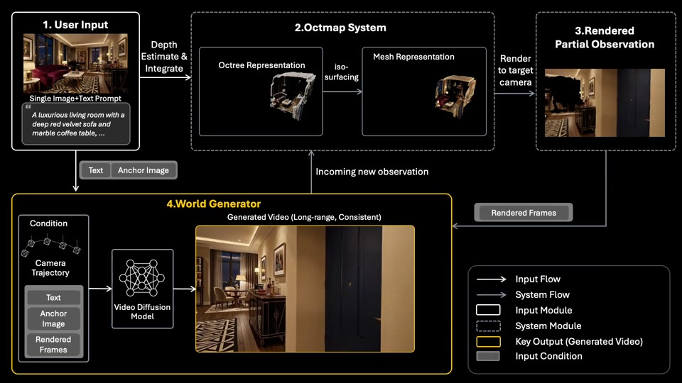
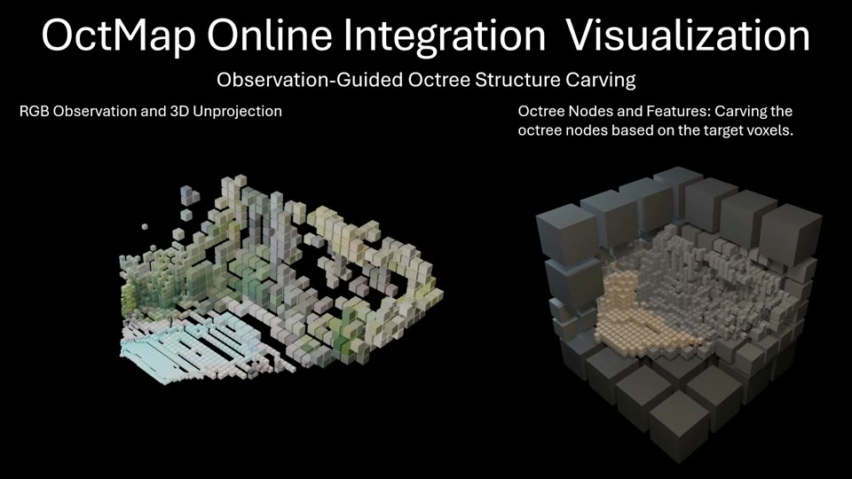

# OctWorld: Long-Range World-Consistent Video Generation with Octree-based 3D Mapping

[](https://arxiv.org/abs/2609.03919)
[](https://maxtirerror.github.io/octworldpage/)
[](https://github.com/microsoft/OctWorld)
[](LICENSE)

**Official code repository:** [microsoft/OctWorld](https://github.com/microsoft/OctWorld).
The repository is currently private; sign in with an account that has access.
Unauthenticated requests return **404** (checked September 24, 2026); this is not a
replacement or placeholder URL.

**OctMap-Guided Generation with Precise Camera Control**

<video src="https://maxtirerror.github.io/octworldpage/assets/method/octmapworkflowillu_v1.mp4" poster="assets/readme/overview-workflow.jpg" controls muted loop playsinline preload="metadata" width="960">
    <a href="https://maxtirerror.github.io/octworldpage/assets/method/octmapworkflowillu_v1.mp4"></a>
</video>

**Inside OctMap Online Integration**

<video src="https://maxtirerror.github.io/octworldpage/assets/method/Octmap_Visualization_combined.mp4" poster="assets/readme/overview-integration.jpg" controls muted loop playsinline preload="metadata" width="960">
    <a href="https://maxtirerror.github.io/octworldpage/assets/method/Octmap_Visualization_combined.mp4"></a>
</video>

*If inline playback is unavailable, open the [generation workflow video](https://maxtirerror.github.io/octworldpage/assets/method/octmapworkflowillu_v1.mp4),
the [online integration video](https://maxtirerror.github.io/octworldpage/assets/method/Octmap_Visualization_combined.mp4),
or the [project page](https://maxtirerror.github.io/octworldpage/#overview).*

**OctWorld** is a video generation framework with persistent **3D spatial memory**.
Starting from a single image, it generates explorable scenes along user-specified
camera trajectories. Its spatially adaptive octree map, **OctMap**, accumulates
geometry and appearance from generated RGB-D observations and renders spatial
conditions for subsequent chunks, helping preserve world consistency over long
camera paths and revisits.

This release provides the **Wan-based inference pipeline, OctMap, depth prediction,
and custom-input examples**. The training-data pipeline and training code are not
released yet.

## ✨ Features

### 1. Long-Range, World-Consistent Generation

Autoregressive video generation backed by a persistent 3D map, with spatial
conditioning from previously observed regions when the camera returns to them.

### 2. Adaptive Octree Spatial Memory

OctMap progressively fuses RGB-D observations into a sparse octree. Spatial
resolution adapts to image evidence, retaining useful geometry and appearance
without a uniformly dense scene representation.

### 3. User-Controlled Camera Trajectories

Condition generation on a first-frame image, camera poses, anchor depth, and text.
The customization tools turn camera-movement instructions into trajectories,
with optional smooth interpolation, MoGe anchor depth, and Qwen3-VL prompt planning.

### 4. Single-Case and Batch Inference

Run one scene or reuse a loaded model across a dataset. Three bundled examples
cover a real image with its original trajectory, the same image with a custom
trajectory, and a synthetic image with a custom trajectory.

## 🗺️ TODO / Release Checklist

- [x] Release the paper and project page.
- [x] Release single-case and batch world-generation inference code.
- [x] Release OctMap spatial memory and depth-prediction integration.
- [x] Release example inputs and custom camera-trajectory tools.
- [ ] Publish **OctWorld-1.5** weights for public access on [Hugging Face](https://huggingface.co/Maxtir/OctWorld-1.5).
- [ ] Release **datapipe** — training-data processing and preparation (**not released yet**).
- [ ] Release **training code** — end-to-end training and fine-tuning (**not released yet**).

Checked code items describe what is included in this source snapshot, not public
repository access. The custom-input builder below prepares **inference inputs**;
it is not the unreleased training-data pipeline.

## 🛠️ Installation

### Prerequisites

- **System:** Linux x86_64, Python **3.10** (current environment: 3.10.21).
- **Hardware:** an NVIDIA Ampere-or-newer GPU with **at least 70 GB of GPU memory**.
  The current environment uses an **A100 80 GB**.
- **Toolchain:** **CUDA Toolkit 12.6**, a compatible NVIDIA driver, a C++ compiler,
  Git, and FFmpeg. The toolkit is needed for native rendering extensions, not just
  the CUDA runtime bundled with PyTorch.
- **Runtime:** **PyTorch 2.8.0+cu126**, **torchvision 0.23.0+cu126**,
  **xformers 0.0.32.post2**, and **flash-attn 2.8.3**.

### Installation Steps

1. Clone the official repository, including the pinned depth-model submodules:

    ```bash
    git clone --recurse-submodules https://github.com/microsoft/OctWorld.git
    cd OctWorld
    ```

    Access to [microsoft/OctWorld](https://github.com/microsoft/OctWorld) is required
    until it becomes public. For SSH-authenticated collaborators, the remote is
    `git@github.com:microsoft/OctWorld.git`. A 404 or "Repository not found" may mean
    the active credentials lack access. For an existing checkout, run
    `git submodule update --init --recursive`.

2. Activate a Python 3.10 environment. If needed, create it first:

    ```bash
    conda create -n base-pt python=3.10.21 -y
    conda activate base-pt
    ```

    Skip the creation command if the environment already exists.

3. Install the pinned inference and custom-input dependencies:

    ```bash
    export CUDA_HOME=/usr/local/cuda-12.6
    bash setup.sh
    ```

    [setup.sh](setup.sh) installs into the selected environment using its Python;
    it does not create environments, install system packages, or download weights.
    It uses [requirements.txt](requirements.txt), protects the CUDA stack with
    [constraints.txt](constraints.txt), and pins native/Git dependencies to the
    revisions used by the current environment.

4. Check an existing environment without reinstalling anything:

    ```bash
    python scripts/check_environment.py
    ```

    This checks imports, DA3's fused FFN, GPU capacity, and small FlashAttention /
    nvdiffrast CUDA operations without loading any model weights. See the
    [installation notes](docs/installation.md) for system prerequisites, dependency
    choices, and the CPU-only import check.

## 📦 Pretrained Models

### OctWorld-1.5

**OctWorld-1.5** is the Wan 14B-based world-generation model. Its model repository is
[Maxtir/OctWorld-1.5](https://huggingface.co/Maxtir/OctWorld-1.5) on Hugging Face.
The repository is currently **private**, and the complete upload has not yet
passed verification; this link is **not an announcement of a public or complete
download**. The intended checkpoint is **v2 / run1 / step7000**, as described in
the [inference guide](example/worldgen/wan/README.md).

This is the **only model package deliberately skipped** by the auxiliary downloader
below. Generation requires it and cannot run from auxiliary weights alone. If a
complete package has been provided separately, place it in the layout shown below.

### Download All Auxiliary Models

```bash
python scripts/download_models.py
```

The [downloader](scripts/download_models.py) prepares **all six auxiliary components**
for inference and custom-input preparation. Every Hugging Face revision and file
hash is pinned in the [model manifest](scripts/model_manifest.json).

| Component | Upstream source | Used for |
| :--- | :--- | :--- |
| Wan VAE / T5 / CLIP + tokenizers | [Wan2.1-I2V-14B-480P](https://huggingface.co/Wan-AI/Wan2.1-I2V-14B-480P) | Image, text, and video encoding/decoding; the original Wan DiT is **not** downloaded. |
| DA3 Nested Giant-Large 1.1 | [DA3NESTED-GIANT-LARGE-1.1](https://huggingface.co/depth-anything/DA3NESTED-GIANT-LARGE-1.1) | Per-chunk depth aligned to user cameras. |
| RAFT Large | [Torchvision checkpoint](https://download.pytorch.org/models/raft_large_C_T_SKHT_V2-ff5fadd5.pth) | Keyframe selection. |
| Sky segmentation | [skyseg](https://huggingface.co/JianyuanWang/skyseg) | Sky masking before integration. |
| MoGe v1 | [moge-vitl](https://huggingface.co/Ruicheng/moge-vitl) | Anchor depth and intrinsics for custom inputs. |
| Qwen3-VL-8B-Instruct | [Qwen3-VL-8B-Instruct](https://huggingface.co/Qwen/Qwen3-VL-8B-Instruct) | Prompt planning for custom inputs. |

These auxiliary files occupy approximately **42.44 GB (39.53 GiB)**, excluding
OctWorld-1.5, temporary downloads, and generated outputs. Matching local files
are verified and reused; available matching Hugging Face cache files are copied
into the expected layout. Mismatched existing files are reported, never silently
overwritten. Hugging Face transfers support resuming incomplete downloads.

List the plan without network access or file changes, or verify all downloaded
files offline (including their hashes):

```bash
python scripts/download_models.py --list
python scripts/download_models.py --check
```

Use `--models wan da3 raft skyseg` for bundled-case inference only, or
`--models moge qwen` for custom-input preparation only. The default downloads both
groups. No private OctWorld repository ID or access token is required for the
public auxiliary downloads.

The default output is the repository's local model directory, independent of the
shell's working directory. Model weights are **not stored in Git**:

```text
model_weights/
├── octworld-1.5/
│   ├── model/
│   ├── pipe_config.json
│   └── neg_text_embed.pt
├── Wan2.1-I2V-14B-480P/    # Wan VAE, T5, CLIP, and tokenizers
├── da3/                   # config.json and model.safetensors
├── raft/                  # RAFT keyframe-selection weights
├── skyseg/                # Sky-segmentation weights
├── moge/
│   └── model.pt            # MoGe v1, loaded locally (no implicit download)
└── Qwen3-VL-8B-Instruct/   # Only needed for custom prompt planning
```

The OctWorld checkpoint uses the **Wan 14B backbone**. Its pipeline configuration
and negative-text embedding are resolved from the model root above the DiT
checkpoint directory. MoGe v1 anchor-depth estimation is needed only when building
new inputs; the bundled inference examples already contain anchor depth and prompts,
so they do not require MoGe or Qwen3-VL to be run again.

## 🚀 Usage

Run all commands from the repository root, with the environment and model weights
prepared. Use a **new or empty output directory** for every generation run;
existing results are not overwritten.

### 1. Image-to-World Generation

The [single-case example](example/worldgen/wan/world_gen.py) defaults to the
bundled DL3DV scene with its original camera trajectory:

```bash
python example/worldgen/wan/world_gen.py \
        --dit_ckpt model_weights/octworld-1.5/model \
        --model_weights_dir model_weights \
        --save_dir outputs/dl3dv_gt
```

This example generates **4 chunks / 321 frames** at **480 × 832 (H × W), 15 fps**.
To try just the first chunk, add `--max_chunks 1` and use a different output
directory. That produces 81 frames, including the input image; it is not a
resume checkpoint for the full run.

Successful single-case runs contain:

| Output | Description |
| :--- | :--- |
| `output.mp4` | Generated RGB video. |
| `depth.mp4` | Colorized inverse-depth visualization, **not metric depth**. |
| `warp.mp4` | Rendered spatial conditions used during generation. |
| `sha256.json` | Seed information and sampling/conditioning tensor hashes. |

The final chunk of a multi-chunk run does not update the map, so its depth-video
segment is black. The default uses **online OctMap integration**, DA3 depth
aligned to user cameras, and seed 425. See the
[inference guide](example/worldgen/wan/README.md) for output semantics, backend
requirements, and reproducibility limits; use `--help` for CLI options.

### 2. Batch Generation

Run all three [bundled cases](assets/README.md) with one model load:

```bash
python example/worldgen/wan/batch_world_gen.py \
        --instances assets/wan_standard/instances.json \
        --dit_ckpt model_weights/octworld-1.5/model \
        --model_weights_dir model_weights \
        --base_folder outputs/batch
```

Results are written under `outputs/batch/instances/<sample_id>/`, together with
per-case metadata and success/failure markers. For multiple single-GPU workers,
the runner supports `--rank` and `--world_size`; select each worker's GPU with
`CUDA_VISIBLE_DEVICES`.

### 3. Custom Images and Camera Paths

The [customization example](example/customize_world_gen/README.md) converts an
image and a camera-turn file into the same `wan_standard` format used by batch
inference. It plans prompts with Qwen3-VL, estimates anchor depth with MoGe v1,
and validates the generated dataset before publishing it.

Build a custom case from the bundled editable Minecraft input without modifying
the original assets:

```bash
python example/customize_world_gen/build_wan_standard.py \
        --image assets/raw/MinecraftCanyon/image.png \
        --camera-movement assets/raw/MinecraftCanyon/camera_turns.txt \
        --dl3dv-source assets/wan_standard \
        --model-dir model_weights/Qwen3-VL-8B-Instruct \
        --smooth-camera \
        --output outputs/my_case/wan_standard
```

Then generate its video:

```bash
python example/worldgen/wan/batch_world_gen.py \
        --instances outputs/my_case/wan_standard/instances.json \
        --base_folder outputs/my_case/generated
```

Replace the image and camera-turn paths with your own to explore a new scene.
Each turn adds 80 generated frames; optional smoothing preserves turn-boundary
keyframes. The [customization guide](example/customize_world_gen/README.md)
documents supported movements, trajectory preview, dataset validation, and
rebuilding the complete bundled dataset.

## 🧩 Components and Acknowledgements

- **[OctWorld](octworld):** Wan-based models and autoregressive inference pipelines.
- **[Spatial Memory](spatial_memory):** OctMap mapping and spatial-condition rendering.
- **[Depth Prediction](depth_prediction):** depth-model wrappers and camera alignment.
- **[Examples and Assets](assets/README.md):** ready-to-run inputs and editable custom cases.

This project builds on [Wan](https://github.com/Wan-Video/Wan2.1),
[Depth Anything 3](https://github.com/ByteDance-Seed/Depth-Anything-3),
[MoGe](https://github.com/microsoft/MoGe),
[Qwen3-VL](https://github.com/QwenLM/Qwen3-VL),
[RAFT](https://github.com/princeton-vl/RAFT), and
[nvdiffrast](https://github.com/NVlabs/nvdiffrast). We thank their authors for
making these tools available.

## ⚖️ License

The code is released under the [MIT License](LICENSE). Third-party code, model
weights, and datasets remain subject to their respective licenses and usage terms.

## 📚 Citation

If you find OctWorld useful for your research, please cite our paper:

```bibtex
@article{lv2026octworld,
    title   = {OctWorld: Long-Range World-Consistent Video Generation
                         with Octree-based 3D Mapping},
    author  = {Lv, Zelong and Xu, Sicheng and Xiang, Jianfeng and
                         Wang, Ruicheng and Dong, Yue and Deng, Yu and
                         Sun, Guangzhong and Yang, Jiaolong},
    journal = {arXiv preprint arXiv:2609.03919},
    year    = {2026}
}
```

## Contributing

This project welcomes contributions and suggestions.  Most contributions require you to agree to a
Contributor License Agreement (CLA) declaring that you have the right to, and actually do, grant us
the rights to use your contribution. For details, visit [Contributor License Agreements](https://cla.opensource.microsoft.com).

When you submit a pull request, a CLA bot will automatically determine whether you need to provide
a CLA and decorate the PR appropriately (e.g., status check, comment). Simply follow the instructions
provided by the bot. You will only need to do this once across all repos using our CLA.

This project has adopted the [Microsoft Open Source Code of Conduct](https://opensource.microsoft.com/codeofconduct/).
For more information see the [Code of Conduct FAQ](https://opensource.microsoft.com/codeofconduct/faq/) or
contact [opencode@microsoft.com](mailto:opencode@microsoft.com) with any additional questions or comments.

## Trademarks

This project may contain trademarks or logos for projects, products, or services. Authorized use of Microsoft
trademarks or logos is subject to and must follow
[Microsoft's Trademark & Brand Guidelines](https://www.microsoft.com/legal/intellectualproperty/trademarks/usage/general).
Use of Microsoft trademarks or logos in modified versions of this project must not cause confusion or imply Microsoft sponsorship.
Any use of third-party trademarks or logos are subject to those third-party's policies.
